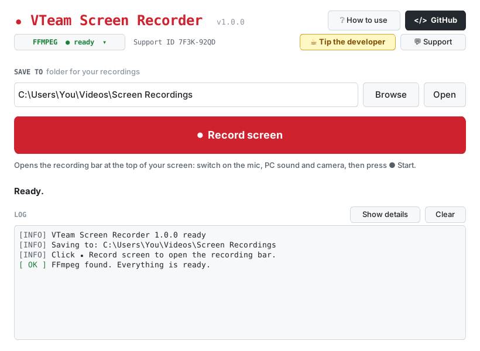

# ⏺ VTeam Screen Recorder

A free Windows screen recorder: **record the full screen as one MP4 with PC sound and your mic, kept in sync**, with an optional **webcam bubble or background-free cutout**, and **pause / resume**. A compact dark bar, like the Windows Snipping Tool, controls it and never shows in the video.

**[⬇ Download VTeamScreenRecorder.exe (latest release)](https://github.com/souldraft/vteam-screen-recorder/releases/latest)** · [Website](https://souldraft.github.io/vteam-screen-recorder/)

---

## Download (Windows 10/11, 64-bit)

1. Go to **[Releases](https://github.com/souldraft/vteam-screen-recorder/releases/latest)** and download **`VTeamScreenRecorder.exe`** (about 50 MB, one file, nothing to install).
2. Put it in **its own folder**, for example `Documents\VTeam Screen Recorder`. The app keeps its settings (`recorder-settings.json`) and a `tools` folder next to the .exe.
3. Double-click it. Windows may show a blue **"Windows protected your PC"** box because the app isn't code-signed yet: click **More info** → **Run anyway**.
4. On first launch the app checks for **FFmpeg** and offers to install it for you (winget, or an official GitHub download as backup).

> Want to check the file? Each release lists the **SHA-256** of the .exe. In PowerShell: `Get-FileHash .\VTeamScreenRecorder.exe -Algorithm SHA256`

---

## Free, with optional tips

**Every feature is free**: no watermark, no time limit, no account, no ads.

If the app is useful to you, click **☕ Tip the developer** in the app (or use the [tip box on the website](https://souldraft.github.io/vteam-screen-recorder/#donate)), tick the box to confirm it's a voluntary gift, and scan the UPI QR code (₹20 to ₹300, any UPI app). Tips don't buy or unlock anything.

---

## How to use

1. **SAVE TO**: the folder for your recordings (`Videos\Screen Recordings` at first). Click **Browse** to change it.
2. Click **⏺ Record screen**. A compact dark bar appears at the top of your screen.
3. Switch on what you want (icons only; hover an icon to see its name): **microphone**, **PC sound** (everything you hear) and **camera**. Lit = on.
   - The **mic icon shows your voice live**: grey when it's quiet, green when you speak, red after a few seconds of non-stop talking.
   - **▾ next to the camera** picks **Bubble** or **Cutout (no background)**, the size (Small to Extra large) and which camera.
   - **⚙** has 30/60 fps, Standard/High quality, the mouse pointer and minimise-while-recording.
4. Click **● Start**. After a 3-second countdown (**✕ Cancel** stops it) the timer runs. The small **pause** icon next to Stop pauses (that part is left out of the video); **▶** goes on.
5. Click **■ Stop**. You get `Screen Recording YYYY-MM-DD HH-MM-SS.mp4` in your SAVE TO folder, with **▶ Play video** and **Show in folder**.

A **How to use** guide opens with the app (untick "Show this guide when the app opens" to stop it), and **❔ How to use** reopens it.

### Good to know
- The bar and the app are **hidden from the recording** (Windows 10 version 2004 or newer). The camera bubble **is** recorded.
- **Cutout (no background)** uses Google's MediaPipe selfie segmentation model (`selfie_segmentation.onnx`, 0.5 MB, Apache 2.0) through `onnxruntime`, about 4 ms per frame on the CPU. Best with good light and a plain wall behind you.
- The camera is read through FFmpeg (DirectShow), so there's nothing extra to install. If it won't start, close other apps that use it and check Settings > Privacy & security > Camera > "Let desktop apps access your camera".
- If the mic icon stays grey while you talk, the app warns you. Check the mute key on your keyboard, Settings > System > Sound > Input, and Settings > Privacy & security > Microphone.
- Encoding uses your **graphics card** (NVIDIA NVENC, Intel Quick Sync or AMD AMF) when available, with the CPU (x264) as fallback. Capture uses Windows Desktop Duplication (`ddagrab`), with `gdigrab` as fallback. The first recording checks what your PC supports.
- **Sync:** FFmpeg records the picture and the app records the sound (WASAPI via `soundcard`); both are stamped with the system clock and lined up when saving. In testing, sound and picture stayed within about one video frame, including across pauses.
- DRM players (Netflix, Prime Video…) show black in any recording; that's Windows' copy protection. **Tell people before recording a call.**

---

## Troubleshooting

| Problem | Fix |
|---|---|
| "Windows protected your PC" when opening the .exe | The app isn't code-signed yet. Click **More info** → **Run anyway** |
| "FFmpeg is missing" | Click **Install automatically** in the yellow bar, or run `winget install --id Gyan.FFmpeg -e` |
| No PC sound in the recording | Make your speakers/headphones the default output in Windows Sound settings, and check the PC sound icon on the bar is lit |
| No mic sound | See the mic note above |
| Recording looks choppy | Choose **30 fps** and **Standard** quality under **⚙** |
| Defender flags `VTeamScreenRecorder.exe` | A known false alarm with PyInstaller apps. Download only from this repo's Releases page and compare the SHA-256 |
| Anything else | Click **💬 Support** in the app (it adds your support ID and, if you want, a screenshot), or email **vteam732@gmail.com** |

---

## Build from source

The source is here so you can see how the app works. You can build it for your own personal use (see [LICENSE](LICENSE)).

1. Download or clone this repo, then double-click **`build.bat`**. It finds or installs Python, builds `VTeamScreenRecorder.exe`, installs it to `%LOCALAPPDATA%\Programs\VTeamScreenRecorder`, and creates **Desktop** and **Start menu** shortcuts. The first run takes 2–5 minutes.
2. `build.bat admin` builds a version that always runs as Administrator. `uninstall.bat` removes the app, its settings and its tools folder; your recordings are not touched.
3. To run without building: `pip install customtkinter pillow soundcard segno onnxruntime`, then `python VTeamScreenRecorder.py`.

Self-test: `python VTeamScreenRecorder.py --selftest`

| File | Purpose |
|---|---|
| `VTeamScreenRecorder.py` | The whole app in one file: recorder, sound, camera, FFmpeg installer, GUI |
| `build.bat` / `uninstall.bat` | One-click build + install + shortcuts / remove |
| `icon.ico` | App icon |
| `selfie_segmentation.onnx` | Background-removal model for the camera cutout (Apache 2.0, licence in `selfie_segmentation.LICENSE.txt`) |
| `scripts/make_donate_qr.py` | Makes the website's tip QR codes for a UPI ID (same code as the app) |
| `CLAUDE_CODE_PROMPT.md` | Technical notes for working on the app with Claude Code |
| `CHANGELOG.md` | What changed in each version |
| `docs/` | The website (GitHub Pages) |

**Tech:** Python 3.12 · customtkinter · Pillow · soundcard · NumPy · segno · ONNX Runtime · PyInstaller · FFmpeg. Licences: [THIRD_PARTY_NOTICES.md](THIRD_PARTY_NOTICES.md)

---

## About

Made by **Shiva Kaja** ([souldraft](https://github.com/souldraft)), written with **Claude**. The recorder is the same one that's inside [Video Downloader](https://github.com/souldraft/video-downloader), as a small app of its own. Tested before release with real recordings (a flash-and-beep sync test with a pause in the middle), fake microphones and test cameras, and window checks of each state. See [CHANGELOG.md](CHANGELOG.md).

© 2026 Shiva Kaja. All rights reserved. See [LICENSE](LICENSE).
